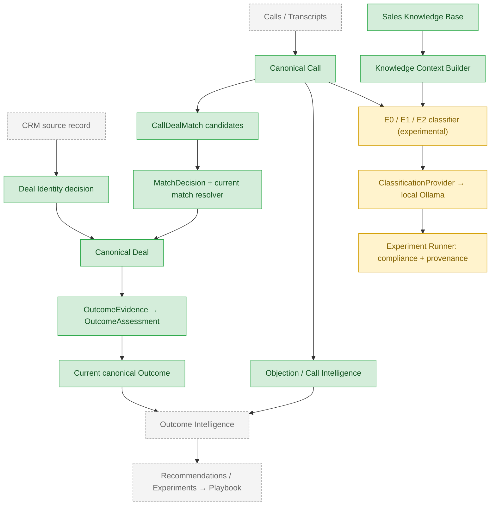

# AI Closer

Outcome-linked Sales Intelligence for high-ticket sales operations.

[](https://github.com/mori-mkm/closer-ai/actions/workflows/ci.yml)


AI Closer transforms sales conversations into structured commercial evidence, connects that
evidence to CRM deals, and learns which behaviors and strategies are associated with better
outcomes.

The goal is not to build an AI that tells salespeople how to sell. The goal is to build a
system that continuously discovers how a specific sales operation sells better.

## Why AI Closer

This is not a call summarizer, a sales chatbot, an "AI coach," or a closer leaderboard.
Summaries lose the structure that matters, coaching tips without evidence are opinions, and
ranking a handful of closers is statistically unsupported. AI Closer treats every call as evidence
for a commercial hypothesis, ties that evidence to a real deal, and measures what correlates with
winning — for one operation at a time.

## Product thesis

The commercial unit of analysis is the **Deal**, not the call. A deal can span multiple calls, so:

```
Call outcome != Deal outcome
```

`Call` has no outcome field. The canonical commercial outcome lives on the Deal, as an append-only
evidence → assessment chain ([ADR-001](docs/decisions/ADR_001-outcome-contract-v0.md)). The
`Deal.outcome` field is only a legacy projection of the CRM state.

## Architecture



- **Green:** implemented as code/contracts with tests, validated only on synthetic data.
- **Yellow:** experimental AI stack, run locally on synthetic calls only.
- **Gray:** real sources and later stages, not built.

The durable decisions are in [`docs/decisions/`](docs/decisions/), the conceptual model in
[`docs/architecture/DATA_MODEL.md`](docs/architecture/DATA_MODEL.md), and the operational state in
[`docs/context/CURRENT_STATE.md`](docs/context/CURRENT_STATE.md).

## Current status

```
Implemented (tests; synthetic data only)
✅ Canonical Call + Agro source-boundary parser (source format still a hypothesis)
✅ Lead / Deal / StageEvent; Deal Identity (CRM record ≠ Deal) + explicit Deal foundation
✅ Call ↔ Deal candidates (CallDealMatch) + authoritative current match (MatchDecision)
✅ Outcome Domain v0 structural core (evidence, disposition, assessment, human authority)
✅ ObjectionEvent v0 + rule-based extractor + synthetic eval harness
✅ Sales Knowledge Base v0.1 + Knowledge Context Builder (full-context, no retrieval)
✅ Objection classifier with E0 / E1 / E2 arms, ClassificationProvider seam
✅ Local-only Ollama provider; Experiment Runner (operational compliance + provenance)
✅ CI, privacy boundary, private OCI storage foundation (synthetic smoke test only)

Designed / drafted, not implemented
🟡 ObjectionEpisode v1, taxonomy v0.1, annotation guideline v0.1, calibration kit v0.1
🟡 Real Outcome policy (blocked on business decisions)
🟡 E3 selective retrieval, E4 semantic retrieval (deferred)

Blocked on real data / authorization
🔒 Real calls (Agro, Empreende), CRM (Kommo) adapter, real matching
🔒 Real golden set / D3 pilot → any quality evaluation of the classifier
🔒 Outcome Intelligence
```

Passing tests do not mean production-ready. A synthetic E0/E1/E2 run shows that the pipeline
executes; it does not show that the classifier is accurate or that any arm is better. E2 is
full-context knowledge augmentation, not semantic RAG: there are no embeddings and no vector DB.

## Repository structure

```
src/closer_ai/
├── normalization/   # Canonical Call, Participant, TranscriptSegment, deterministic IDs
├── ingestion/       # Agro/Zoom source-boundary parser (synthetic-validated), source profiler
├── domain/          # Lead, Deal, StageEvent, Deal Identity, CallDealMatch + MatchDecision,
│                    # Outcome (evidence/assessment), ObjectionEvent, Call → Deal → Outcome composition
└── ai/              # rule-based objection extractor, Knowledge Context Builder,
                     # E0/E1/E2 classifier, Ollama provider, Experiment Runner

tests/    # unit + integration tests, hermetic (no network, no Ollama, no real data)
evals/    # synthetic evaluation harness (objection_v0)
docs/     # decisions (ADRs), architecture, domain contracts, AI, evals, data protocols, knowledge
data/     # local-only staging for real data (gitignored) — never committed
```

## Quickstart

```bash
git clone https://github.com/mori-mkm/closer-ai.git
cd closer-ai
python -m venv .venv
# Windows: .venv\Scripts\activate    macOS/Linux: source .venv/bin/activate
pip install -e ".[dev]"
pytest -q
ruff check .
```

The test suite needs no Docker, no database, no external service and no Ollama. Running the
classifier against a real local model is optional and documented in
[`docs/ai/OLLAMA_CLASSIFICATION_PROVIDER_V0_1.md`](docs/ai/OLLAMA_CLASSIFICATION_PROVIDER_V0_1.md).

## Tests and CI

CI runs on every pull request and push to `main`: a package import check, `ruff check .`, and
`pytest -q` ([`.github/workflows/ci.yml`](.github/workflows/ci.yml)). The current test count is in
`docs/context/CURRENT_STATE.md`.

## Data and privacy

Do not commit customer data or secrets. That covers transcripts, recordings, CRM exports, names,
emails, phone numbers, API keys and private notes. Treat everything in Git as potentially public.
Fixtures and datasets in the repository are synthetic. Processing real data requires explicit
authorization. The LLM provider is local-only (loopback). Experiment artifacts do not store
transcripts, prompts or raw model responses, and go to the gitignored `artifacts/`. See
[ADR-004](docs/decisions/ADR_004-real-data-privacy-boundary.md) and
[`docs/data/PRIVACY_BOUNDARY.md`](docs/data/PRIVACY_BOUNDARY.md).

When a real-world edge case is found, it is recreated synthetically, never copied with names
swapped.

## Roadmap

```
1. Calibration Dataset Loader + synthetic compliance analysis (no real data needed)
2. Authorized real data → validate source contracts (Agro, Kommo)
3. D3 pilot → real golden set → quality evaluation of E0/E1/E2
4. Real Outcome policy (business decisions) + real Call ↔ Deal linkage
5. Outcome Intelligence
```

An API, dashboard, realtime copilot and production database are later-stage concerns. Full
sequencing: [`docs/product/ROADMAP.md`](docs/product/ROADMAP.md).

## Contributing / Development workflow

One task, one owner, one branch — one worktree when work runs in parallel. Architecture, schema,
and merge decisions stay human-reviewed; agents never merge their own work. Durable architecture
changes need an ADR ([`docs/decisions/README.md`](docs/decisions/README.md)). Details:
[`AGENTS.md`](AGENTS.md), [`CLAUDE.md`](CLAUDE.md), [`docs/agents/WORKFLOW.md`](docs/agents/WORKFLOW.md).

## Documentation

- [`docs/context/CURRENT_STATE.md`](docs/context/CURRENT_STATE.md) — operational snapshot
- [`docs/decisions/`](docs/decisions/) — ADRs (durable decisions)
- [`docs/architecture/`](docs/architecture/) — architecture, data model, integrations
- [`docs/domain/`](docs/domain/) — domain contracts (Deal, identity, matching, outcome, objection)
- [`docs/ai/`](docs/ai/) — knowledge context, classifier, provider, experiment runner, RAG proposal
- [`docs/evals/`](docs/evals/) — golden set protocol, annotation guideline, calibration kit
- [`docs/knowledge/sales/`](docs/knowledge/sales/) — Sales Knowledge Base v0.1
- [`docs/data/`](docs/data/) — real-data onboarding, privacy, OCI storage
- [`docs/product/`](docs/product/) — MVP scope, roadmap
- [`docs/agents/`](docs/agents/) — multi-agent development workflow
